# MAX3: Local-First AI Resident (Showcase)

> **This is a showcase repository.** The MAX3 source code is private. This repo holds the overview, architecture and screenshots so reviewers can see what was built. Questions are welcome through [LinkedIn](https://www.linkedin.com/in/jnewell).

MAX (Modular Algorithmic eXecutor) is a local-first, voice-first AI resident: one process on one machine that reconciles fragmented data, keeps every fact tied to its source, and recommends rather than decides. MAX3 is the third generation. It is built and now frozen; its lessons carry into [MAX4](https://github.com/newellnarco/MAX4-Showcase).

## At a glance

- **Backend:** Python, FastAPI on asyncio with Uvicorn
- **Frontend:** React and TypeScript
- **Data:** a DuckDB property graph, single-writer SQLite stores per subsystem, and a sqlite-vec index for embeddings
- **Integrations:** 40+ external data sources through a crash-safe ingestion pipeline with rate-limit-aware self-healing and circuit breakers
- **Healthcare groundwork:** one typed graph unifying six clinical terminologies (MeSH, RxNorm, openFDA, ICD-10-CM, Disease Ontology, Uberon), with provenance and a confidence score on every node
- **Quality:** 2,500+ automated tests across unit, integration and system levels, gated in CI

## The eleven hard rules

MAX3 is built under eleven hard rules. The core of them:

- Local-first: nothing needs to leave the machine to work.
- Every fact carries its source and confidence.
- Knowledge comes only from sources, never invented.
- Every automated change is audited and reversible, with a 30-second override window.
- Recommend-only, enforced in code.

## Architecture

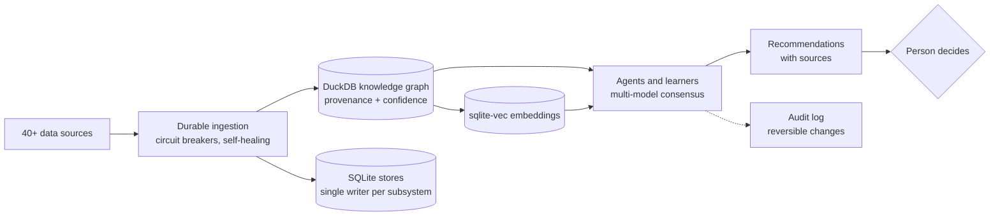

## Screenshots

**Knowledge graph**

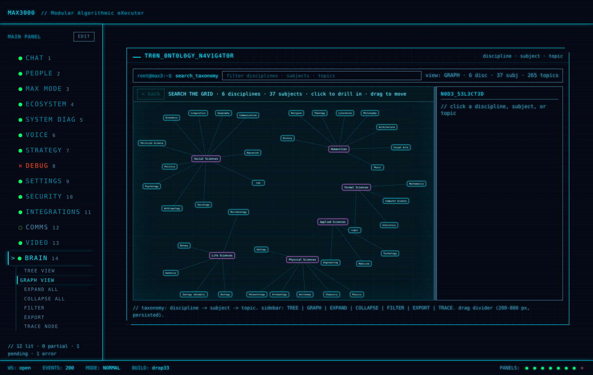

**Knowledge graph, second theme**

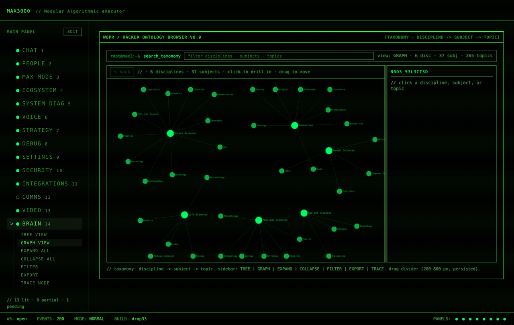

**Taxonomy browser with node detail**

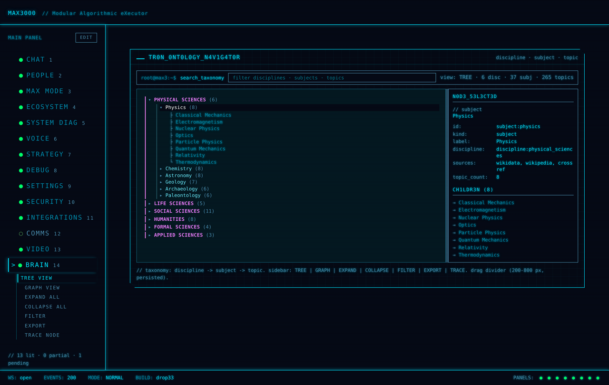

**Taxonomy browser, second theme**

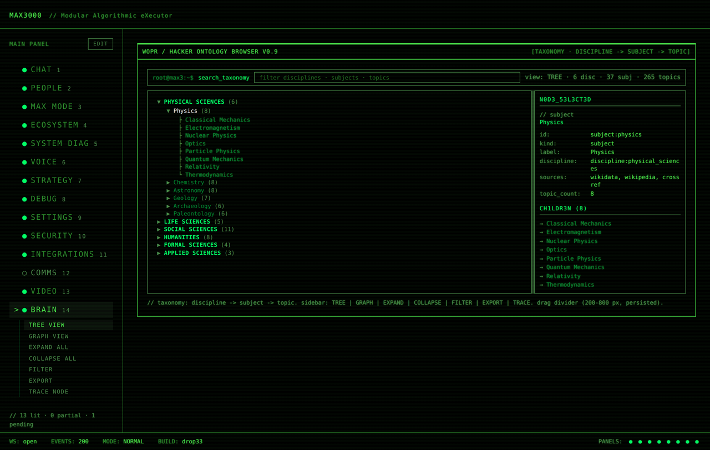

**System monitor**

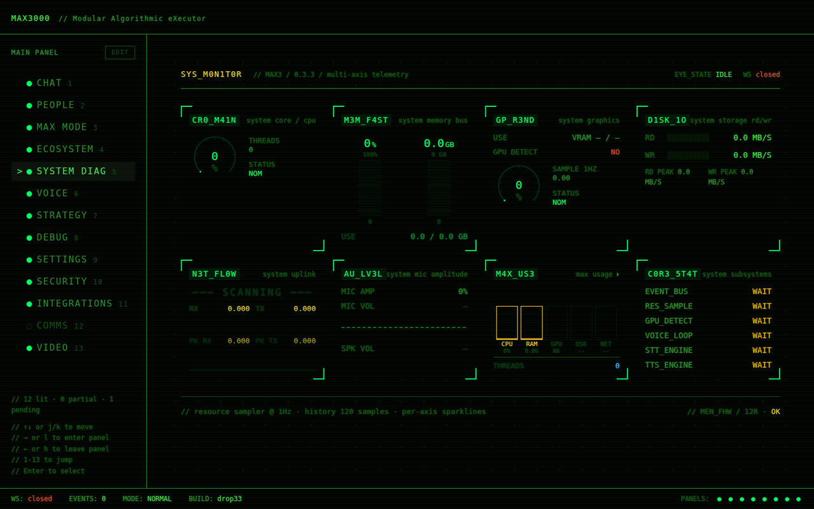

**Voice pipeline**

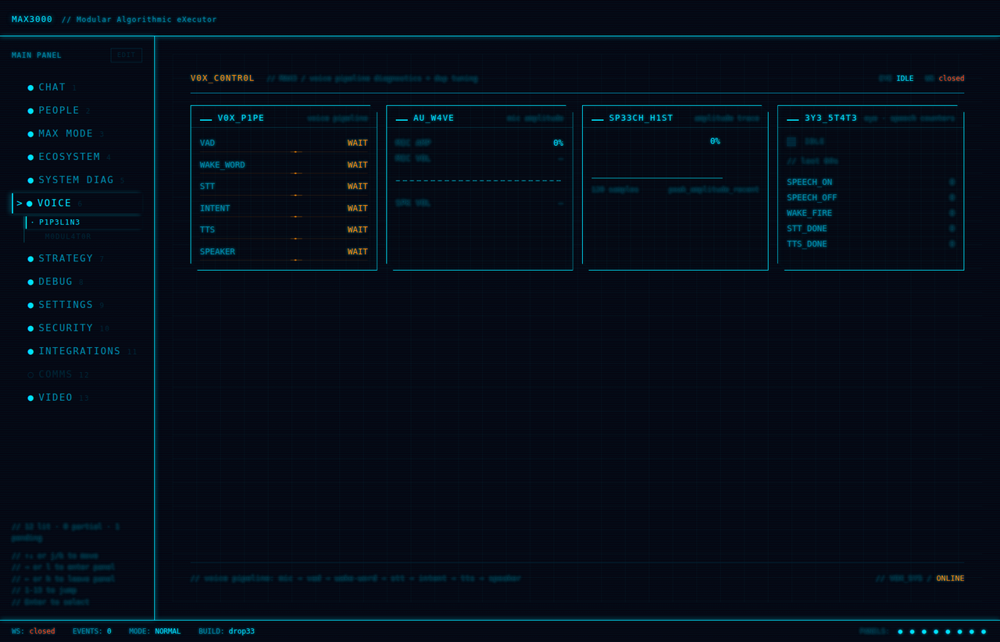

**Voice modulator**

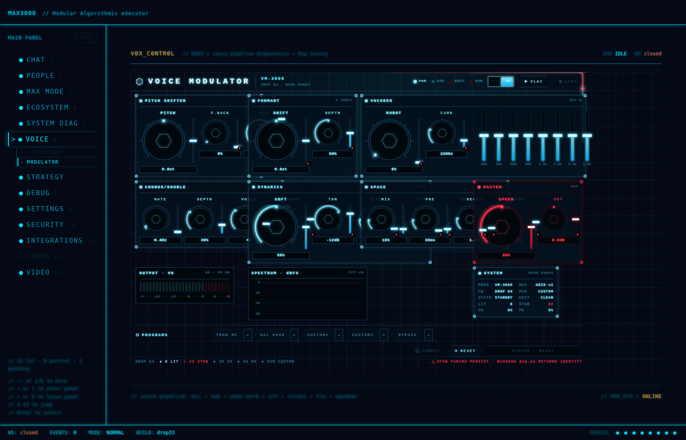

**Voice modulator, dials**

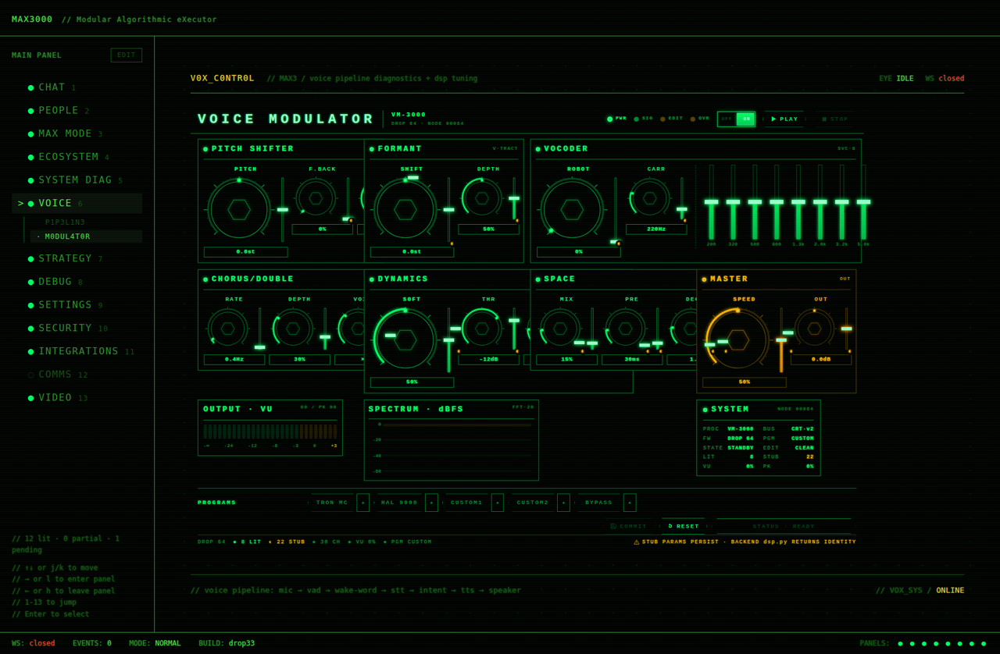

**Voice modulator, second theme**

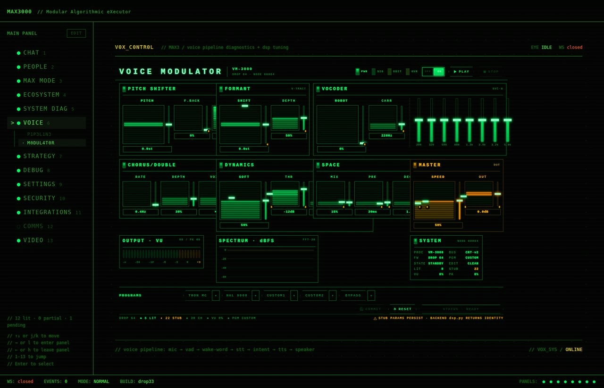

**MAX mode**

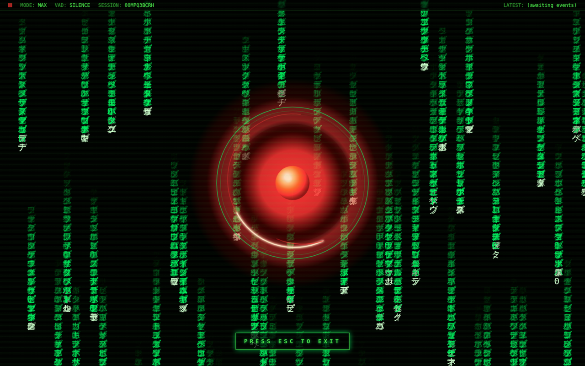

**Strategy games**

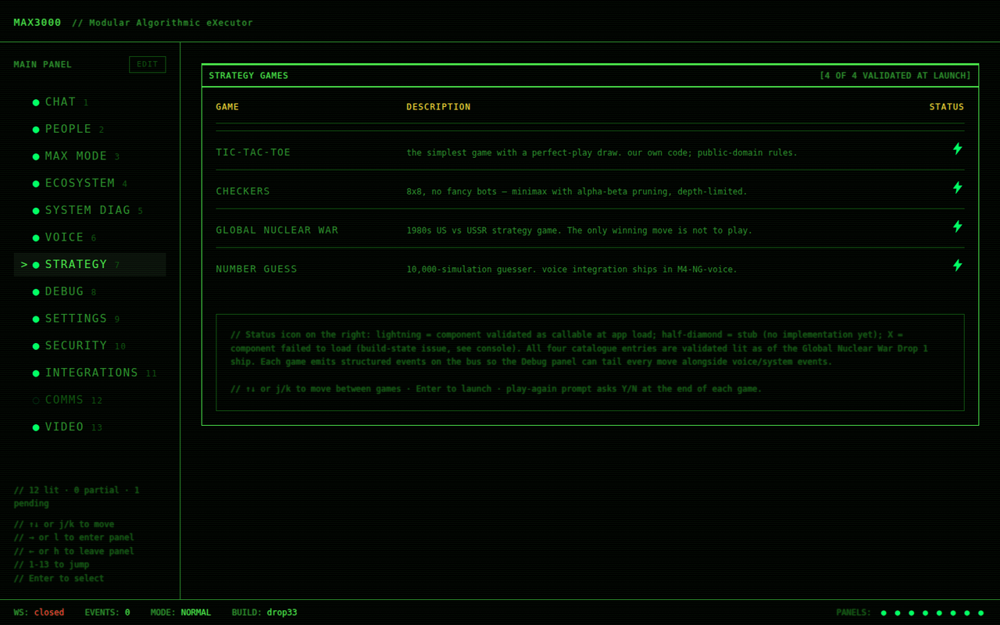

## Read more

- [MAX: The AI Resident, and the Road to MARA](https://www.maxresearchcollective.com) (overview article)
- [MAX Research Collective](https://www.maxresearchcollective.com)
